# 4C CMMS — cloud edition

The web-based, multi-tenant successor to **4CSQL** (4C Systems LLC's Windows CMMS).
One cloud service shared by all customers; each customer is an isolated *organization* (tenant).

| Layer | Technology |
|---|---|
| API | ASP.NET Core 10 (minimal APIs), EF Core 10, SQL Server / Azure SQL |
| Web | React 19, TypeScript, Vite, Mantine 8, TanStack Query, i18next |
| Auth | ASP.NET Identity (secure cookie), tenant-scoped roles & permissions |
| Ops | Docker image (API serves the web app), GitHub Actions CI |

## Screenshots

| Dashboard | Locations |
|---|---|
| 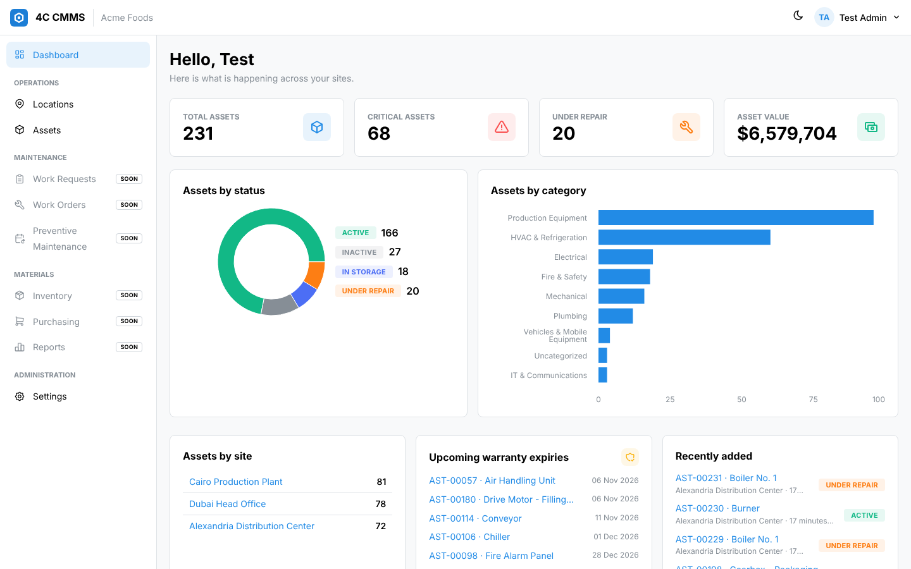 | 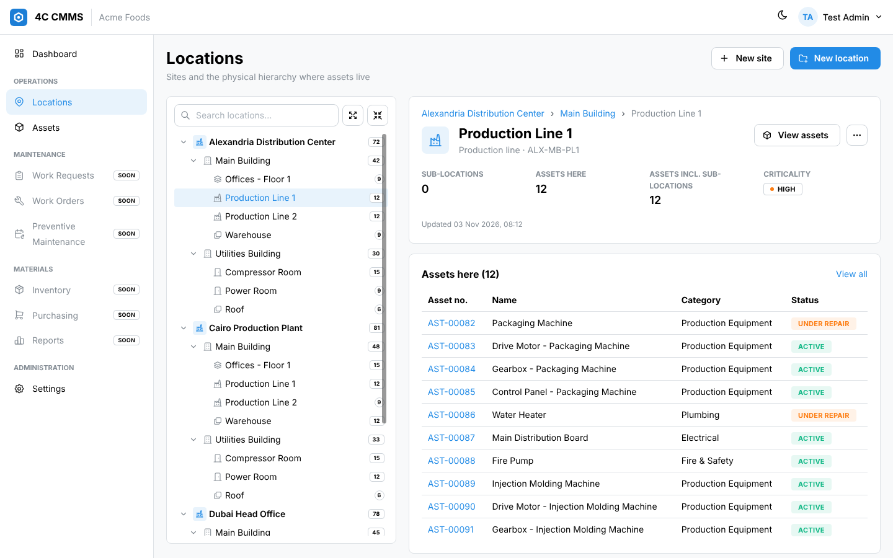 |
| **Assets** | **Asset detail** |
| 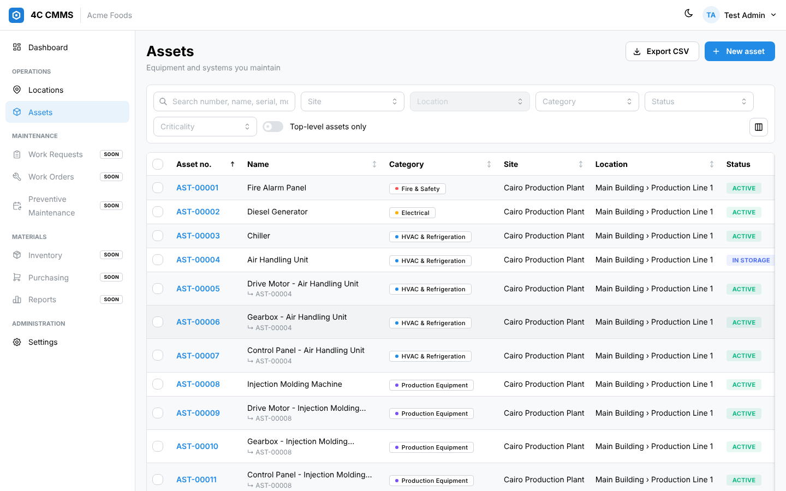 | 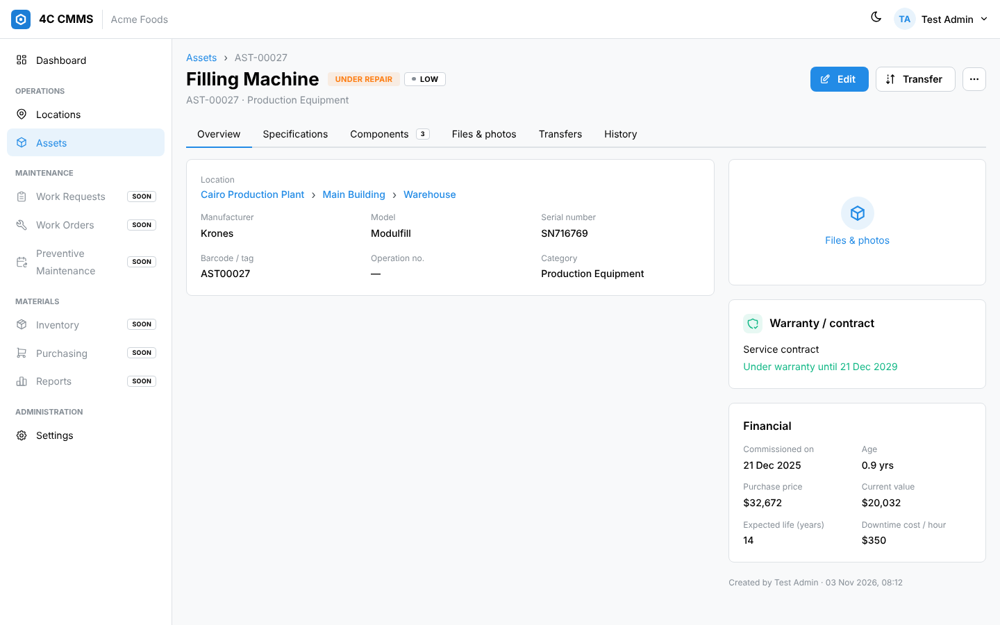 |
| **Work orders** | **Work order** |
| 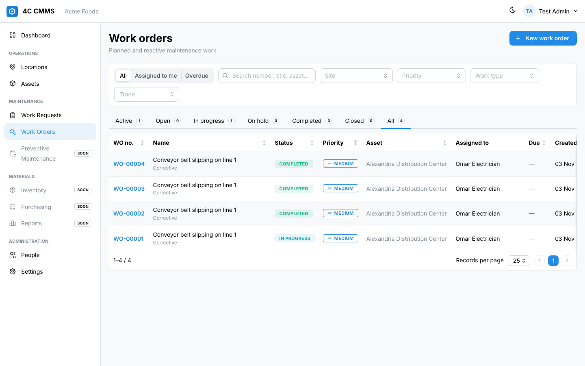 | 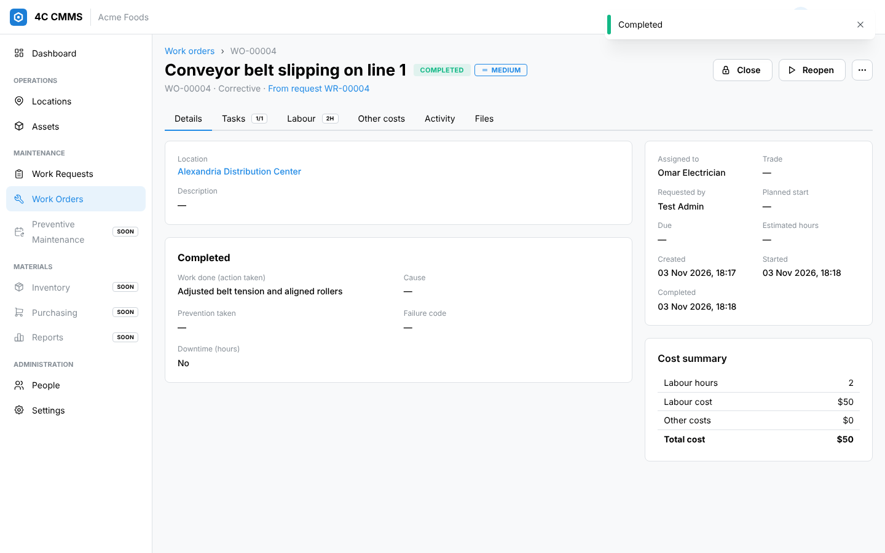 |
| **PM schedules** | **PM generation** |
| 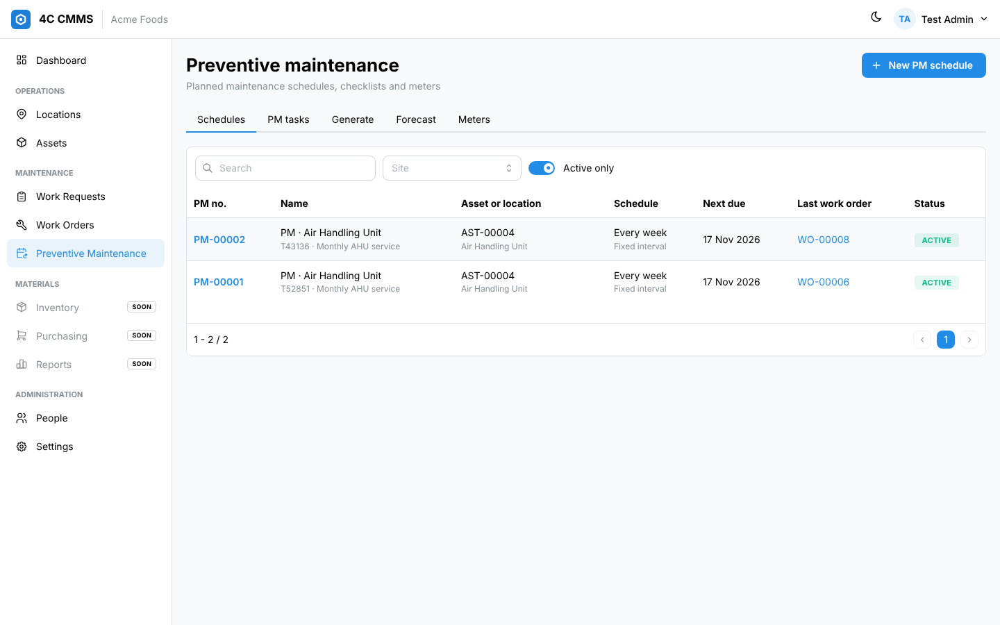 | 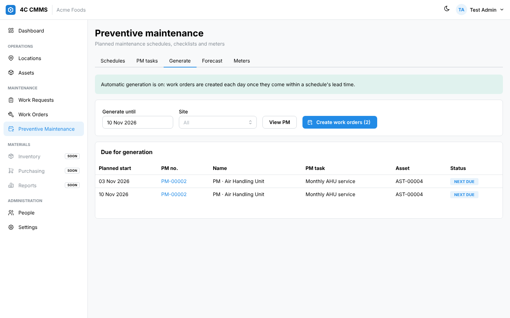 |
| **Inventory** | **Part** |
| 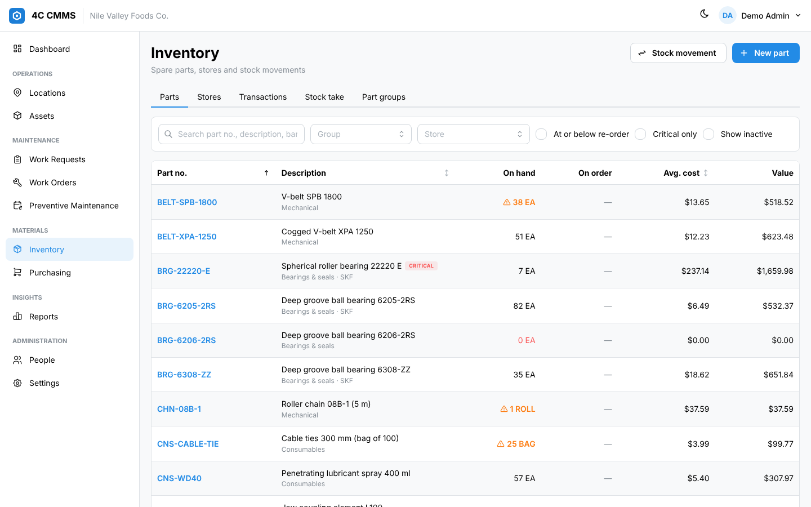 | 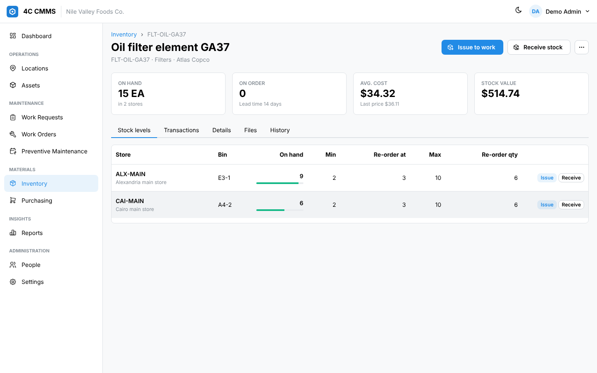 |
| **Re-order proposal** | **Purchase order** |
| 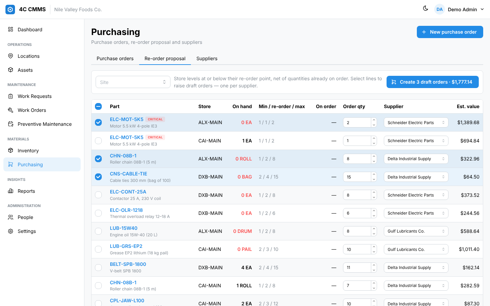 | 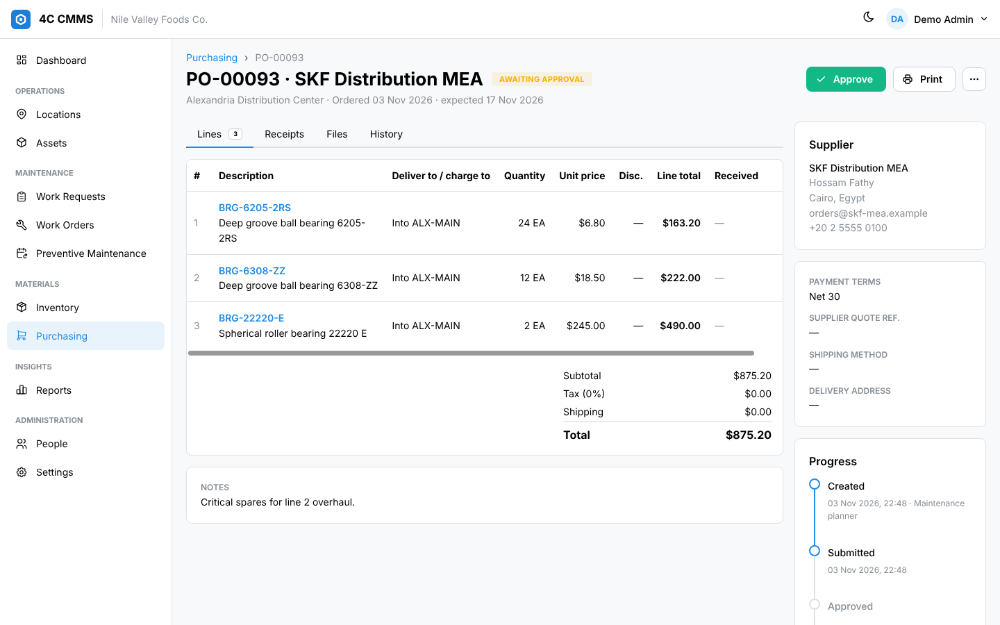 |
| **Maintenance cost report** | **Reliability report (MTBF / MTTR)** |
| 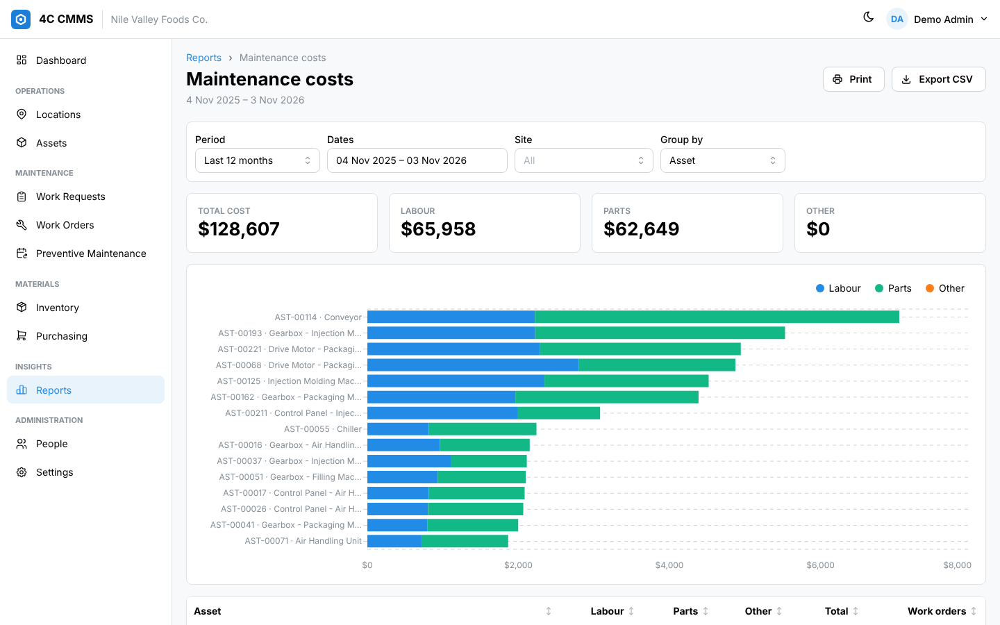 | 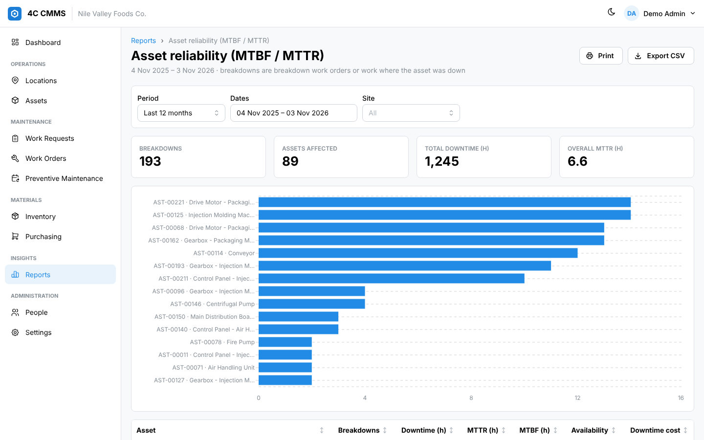 |

## Modules

| Module | Status |
|---|---|
| Platform: organizations, users, roles/permissions, audit trail, files, settings, terminology | ✅ |
| **Locations**: sites → unlimited-depth location tree (areas, buildings, floors, rooms, lines) | ✅ |
| **Assets**: hierarchy (components), categories, custom fields, warranty, financials, transfers, photos/documents, bulk edit, CSV export | ✅ |
| **People**: employees/contractors with trades, rates and sites (optionally linked to a login); trades; failure codes | ✅ |
| **Work requests**: anyone can request work; triage → approve (creates a work order) / reject; duplicate & warranty check | ✅ |
| **Work orders**: workflow (Open → In progress ⇄ On hold → Completed → Closed), assignees, task checklist, labour & other costs, completion details (action/cause/prevention, failure code, downtime), activity feed, files | ✅ |
| **Preventive maintenance**: PM tasks (checklists) and schedules on assets or locations — fixed interval (by scheduled or actual date), nth weekday of month, fixed date of month, meter-based (incremental or threshold, optionally whichever-comes-first with time); multiple PM (heavier task every Nth time); preview & generate, automatic generation with lead time, forecast; meters and readings | ✅ |
| **Inventory**: stores, part groups, parts with per-store bins and min / re-order / max levels, alternates, shelf-life batches with expiry; receive, issue and return to work orders or locations, adjust, transfer, stock take; moving average cost; stock never goes negative unless the part allows it; parts cost on work orders | ✅ |
| **Purchasing**: suppliers; purchase orders (draft → awaiting approval → approved → partly received → received → closed, or cancelled) with per-user approval limits, currency and exchange rate, tax, shipping and line discounts; partial receipts into stores; service lines charged to work orders; re-order proposal that raises draft orders per supplier; printable PO | ✅ |
| **Reports**: 14 reports — work order backlog and throughput, PM compliance, labour hours, asset reliability (MTBF / MTTR / availability), failure Pareto, maintenance costs by asset/site/category/type/trade/month, asset register, stock valuation, re-order, parts consumption, dormant stock, supplier spend with on-time delivery, open purchase orders — with KPIs, charts, sorting, CSV export and print | ✅ |
| **4CSQL importer** (locations, assets, people, trades, failure codes, work requests, work orders with labour, costs, tasks, notes and status history, PM tasks, schedules, meters and readings, stores, parts, levels, suppliers, purchase orders and the stock ledger) | ✅ |
| Mobile & offline, integrations, Arabic | Next — see [docs/ROADMAP.md](docs/ROADMAP.md) |

## Try it on your computer

Needs only [Docker Desktop](https://www.docker.com/products/docker-desktop/) (running, with about 4 GB of memory free) and
the source: `git clone https://github.com/MoXFahmy/CMMSX.git` or **Code → Download ZIP** on GitHub, unzipped.

Windows (PowerShell, in the CMMSX folder):
```powershell
$env:SA_PASSWORD = "Local_Test_2026!"; $env:SQL_PORT = "14333"; docker compose up --build
```

macOS / Linux (Terminal, in the CMMSX folder):
```bash
SA_PASSWORD='Local_Test_2026!' SQL_PORT=14333 docker compose up --build
```

The first start downloads and builds everything (5–10 minutes). When the log shows `Now listening on`, open
**http://localhost:8080**, choose **Create an organization**, then **Load sample data**. Stop with `Ctrl+C`;
`docker compose up` starts it again with your data, and `docker compose down -v` deletes everything.

- `SA_PASSWORD` is the password of the local test database: at least 8 characters, with upper and lower case letters and a digit or symbol.
- `SQL_PORT=14333` keeps the test database off port 1433 in case SQL Server (e.g. for 4CSQL) is already installed.
  If port 8080 is taken, add `APP_PORT=8090` (PowerShell: `$env:APP_PORT = "8090"`) and open http://localhost:8090.
- On Apple-silicon Macs, turn on *Use Rosetta for x86/amd64 emulation* in Docker Desktop's settings (SQL Server needs it).

## Develop

Prerequisites: .NET 10 SDK, Node 22, a SQL Server (the compose file starts one).

```bash
# 1. Database
SA_PASSWORD='YourStr0ng!Pass' docker compose up -d sql

# 2. API (applies migrations on start) — http://127.0.0.1:5080
export ConnectionStrings__Cmms="Server=localhost,1433;Database=Cmms;User Id=sa;Password=YourStr0ng!Pass;TrustServerCertificate=True"
dotnet run --project server/FourC.Cmms.Api --urls http://127.0.0.1:5080

# 3. Web (hot reload, proxies /api) — http://localhost:5173
cd web && npm install && npm run dev
```

Open the app, choose **Create an organization**, then *Settings → Organization → Load sample data*. This creates ~230 demo assets
across three sites and simulates a year of operations — technicians, ~1,000 work orders with labour, downtime and failure codes,
36 PM schedules with realistic compliance, 34 spare parts in three stores, and ~100 replenishment purchase orders — so every
screen and report has data. (It takes a few seconds and runs once per organization.)
API reference: `http://127.0.0.1:5080/api/docs`.

## Deploy to the cloud

GitHub Actions deploys every green build of `main`, signing in to the cloud with short-lived tokens (no stored keys).

- **AWS**: ECS Fargate + RDS for SQL Server + S3, served over HTTPS by CloudFront. See [docs/DEPLOY_AWS.md](docs/DEPLOY_AWS.md).
- **Azure**: Container Apps + Azure SQL + Blob Storage. See [docs/DEPLOY_AZURE.md](docs/DEPLOY_AZURE.md).

## Tests

```bash
export CMMS_TEST_SQL="Server=localhost,1433;User Id=sa;Password=YourStr0ng!Pass;TrustServerCertificate=True"
export CMMS_TEST_BLOB="UseDevelopmentStorage=true"   # optional: Azurite, to test Azure Blob attachments
export CMMS_TEST_S3="http://127.0.0.1:9000"          # optional: an S3 emulator (moto_server, MinIO), to test S3 attachments
dotnet test server/FourC.Cmms.slnx      # unit tests + integration tests (they create and drop their own database)
cd web && npm run build                 # type-check + production build
```

## Migrating a 4CSQL customer

See [docs/LEGACY_MIGRATION.md](docs/LEGACY_MIGRATION.md).

## Project layout

```
server/
  FourC.Cmms.Core/          domain model, EF Core DbContext + migrations, tenant provisioning, location tree
  FourC.Cmms.Api/           HTTP API (Features/*Endpoints.cs), auth, permissions, file storage
  FourC.Cmms.LegacyImport/  4CSQL → cloud importer (console)
  FourC.Cmms.Tests/         API integration tests
infra/aws/cmms.yml          AWS resources (VPC, ECS Fargate, load balancer, CloudFront, RDS, S3, logs)
deploy/aws/                 one-time AWS ↔ GitHub connection (setup.sh + bootstrap.yml, run in CloudShell)
infra/azure/main.bicep      Azure resources (Container Apps, SQL, Storage, registry, logs)
deploy/azure/setup.sh       one-time Azure ↔ GitHub connection (run in Cloud Shell)
web/src/
  pages/                    dashboard, locations, assets, work, pm, inventory, purchasing, reports, settings
  components/               layout, pickers, attachments, audit timeline
  locales/en.json           all UI text (add ar.json etc. for more languages)
```

## Design notes

- **Tenant isolation**: every business table has `TenantId`; EF Core global query filters scope all reads, and
  `SaveChanges` stamps/guards writes (cross-tenant writes throw). Integration tests verify isolation.
- **Audit**: every create/update/delete on business records is recorded with field-level before/after values.
- **Concurrency**: records carry a `RowVersion`; stale edits return HTTP 409 instead of silently overwriting.
- **Hierarchy**: locations store a materialized path, so "all assets under Building A" is a single indexed query.
- **Stock ledger**: every movement is an immutable transaction; the store balance is updated in the same database
  transaction with a conditional `UPDATE … WHERE balance + change >= 0`, so two people issuing the last item at the same
  moment cannot drive stock negative. Average cost is recalculated on each receipt; issues are costed at average cost.
- **Reports** are computed on the server and returned in one generic shape (columns, rows, chart, KPIs), so the web
  client renders, charts, prints and exports every report the same way and new reports need no UI code.
- **Customer-specific needs** are handled with configuration, not code forks: terminology (rename Site/Location/Asset),
  custom fields per asset category, and roles — replacing 4CSQL's 30 `NameplateInfo` columns and 300+ per-client feature flags.
